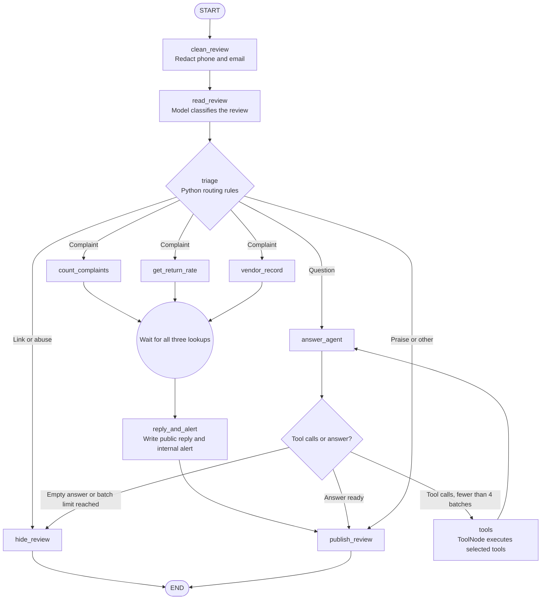

# Hopscotch review moderation — Python hands-on implementation

Build this assignment yourself in VS Code. Start with baseline mode, prove it works,
then enable the two optional exercises. The accompanying `PYTHON_IMPLEMENTATION_GUIDE.md`
contains these instructions followed by the complete contents of every source/configuration
file, in the order to create them. The `reference/` directory is the same implementation
for comparison. No repository has been initialized, created, committed or pushed.

## 1. What you are implementing

The source is the five-page FDE Academy brief, **Hopscotch: Review Moderation**.
It describes a clothing store receiving about 2,000 reviews per day. That is business
context, not a throughput result demonstrated by this implementation.

| Required behavior | Python implementation | Acceptance check |
|---|---|---|
| One shared state | `ReviewState` in `schemas.py` | Nodes return only changed fields |
| Hide phone numbers and emails before model calls | `privacy.py`, `process_review`, `clean_review` | R-5 contains `[PHONE]`; raw number never reaches the model |
| Read the review using a model | `LiveModel.classify` | Structured `kind` and `topic` |
| Route using Python rules | `triage` in `graph.py` | Link/abuse → hide; complaint → lookups; question → agent; praise → publish |
| Fetch complaint history for 14 days | `Catalog.count_complaints` | R-3: 6; R-4: 1 |
| Fetch batch return rate | `Catalog.get_return_rate` | R-3: 16%; R-4: 3% |
| Fetch vendor history for 90 days | `Catalog.vendor_record` | R-3: 2 previous alerts |
| Run all three complaint lookups together | Three graph branches + a join barrier | Barrier test proves concurrent entry and one join |
| Write a public reply and internal alert | `reply_and_alert` | Baseline R-3 and R-4 both alert |
| Choose question tools using the model | `bind_tools` + `ToolNode` | R-2: care and stock together; R-7: size chart, then stock |
| Stop repeated tool execution | Python routes and `tool_rounds` | At most 4 tool batches; final answer after batch 4 is permitted |
| Publish or hold | `publish_review`, `hide_review` | Five published; R-5/R-6 held |
| Optional: alerts only on spikes | `write_reply`, `spike_rule`, `write_alert` | At least 5 complaints OR return rate at least 12%; only R-3 alerts |
| Optional: check and rewrite answers | `check_answer`, `revise_answer` | A failed answer gets at most 2 rewrites, then is held |

The brief's principle is preserved: **the model reads and writes; code routes and
enforces limits**. Classification is a model interpretation; the final lane is a
Python decision. Independent complaint lookups never require an agent.

### Baseline workflow



In the optional `spike` and `checked` modes, complaint replies and alerts use a
spike check instead of the baseline `reply_and_alert` node. `checked` mode also
checks question answers, allows up to two rewrites, and holds answers that still
fail. The CLI can write a Mermaid graph for the selected mode; see Stage E below.

Two concrete examples for each of the six required concepts:

| Concept | Example 1 | Example 2 |
|---|---|---|
| State | `kind='complaint'` records how R-3 was read | `tool_rounds=2` records R-7's tool batches |
| Nodes and edges | `clean_review` → `read_review` | `tools` → `answer_agent` |
| Router | Praise R-1 goes to publication | A link in R-6 overrides its positive wording and goes to moderation |
| Parallel and join | R-3 fetches complaint count, returns, vendor history concurrently | R-4 fetches the same facts and writes its reply only after all three finish |
| Tools | R-2 requests care and stock together | R-7 reads the chart before choosing the stock size argument |
| Loop | R-7 returns from tools to the agent twice | A deliberately endless test agent is stopped after four tool batches |

## 2. Assumptions and scope

These choices fill gaps in the brief; they are not additional assignment requirements.

- Python 3.12 is the tested runtime. The project declares Python 3.11 or newer.
- LangGraph and the LangChain OpenAI adapter are used. The model ID comes from your
  environment; choose one available in your account that supports tool calls and
  structured output. No model or API spend is needed for offline checks.
- Product IDs, height ranges, stock, care instructions and dated records are synthetic
  fixtures. They preserve the brief's specified counts and outcomes. A frozen
  `as_of` time makes the 14-day and 90-day windows reproducible. In a real service,
  use the processing time and actual source records.
- Every explicit HTTP/HTTPS or `www.` link is held in this exercise. A production
  moderation system would need a defined domain policy.
- Complaint rate is a fraction: `0.16` means 16%; the spike threshold is `0.12`.
- The brief does not specify the checker's three rules. Here they are: supported
  claims, complete response to the question, and no phone/email PII or unsupported
  promises. A model judge is useful but does not guarantee correctness.
- `checked` mode includes both optional exercises. `spike` includes only exercise 1.
- Publication and alert delivery are simulated locally in SQLite. An `alert` field
  means an internal alert was generated and stored, not that any person was notified.
  The CLI and its JSON output are internal inspection tools; they include private
  quality facts and alerts and must not be used as a public product-page response.
- Regex redaction handles the assignment's common phone/email formats. It is not
  universal PII detection; it does not promise to detect names, addresses, obfuscated
  contacts or every international format. The raw API input exists briefly in
  memory, but does not enter graph state or persisted results through the service.
- Offline mode is an explicitly scripted simulator for the seven fixtures. Its
  classification and tool choices do not demonstrate LLM reasoning. Live mode uses
  actual model calls for reading, writing, selecting tools and judging answers.
- No web UI, FastAPI server, vector database, authentication or cloud deployment
  is required by the brief. Adding those first would delay the assignment's real work.

## 3. Create the VS Code project

Create a local folder named `hopscotch-review-moderation` and open it in VS Code.
Install the Microsoft Python and Python Debugger extensions. Create the files using
the complete file contents later in the full guide, or inspect `reference/` alongside
your own project as you type. The root is the folder containing `pyproject.toml`.

Create the folder structure in this order:

1. `src/hopscotch/` with `__init__.py`, `schemas.py`, `privacy.py`.
2. `src/hopscotch/data/` with `catalog.json`, `reviews.json`, then `catalog.py`.
3. `tools.py`, `models.py`, `graph.py` inside `src/hopscotch/`.
4. `service.py`, `cli.py` inside `src/hopscotch/`.
5. `tests/test_workflow.py`, `.vscode/settings.json`, `.vscode/launch.json`.
6. Root `pyproject.toml`, `.gitignore`, `.env.example`, `README.md`.

Keep the same spelling for the tool names and graph nodes: the traces and tests use them.
The complete guide includes a flat path inventory, rather than a diagram of directories.

In a macOS/Linux terminal at the project root:

```bash
python3.12 -m venv .venv
source .venv/bin/activate
python -m pip install --upgrade pip
```

In Windows PowerShell:

```powershell
py -3.12 -m venv .venv
.\.venv\Scripts\Activate.ps1
python -m pip install --upgrade pip
```

If PowerShell activation is blocked, use `.\.venv\Scripts\python.exe` instead of
`python` in subsequent commands; no execution-policy change is necessary.

After creating `pyproject.toml` and the package files:

```bash
python -m pip install -e ".[dev]"
```

In VS Code: Command Palette → **Python: Select Interpreter** → choose `.venv`.
The source package layout means the editable install is required before imports.

## 4. Implement in this build order

### Stage A — state, privacy and data

Create `schemas.py`, `privacy.py`, the two JSON data files and `catalog.py` first.
`ReviewInput` validates incoming IDs and text; `ReviewState` describes the internal
shared dictionary. Pydantic validates external/model data; TypedDict alone does not
validate graph state at runtime.

Check redaction immediately after the editable install:

```bash
python -c "from hopscotch.privacy import redact; print(redact('Call 98200 11223 or parent@example.com'))"
```

Expected: `Call [PHONE] or [EMAIL]`.

Read `catalog.json`: R-3's old September complaint must not count toward the 14-day
window, and its old January vendor alert must not count toward the 90-day window.
The ranges are inclusive. The `button` complaint must not count as `colour_bleed`.

### Stage B — tools and model adapters

Create `tools.py` and `models.py`. The tools close over the catalog; `InjectedState`
supplies the current product ID. The model can choose a size but cannot choose
another review's product ID. Those injected arguments are absent from the tool schema.

`LiveModel` binds exactly three tools. `OfflineModel` emits ordinary LangChain
`AIMessage` tool calls, so both paths exercise the real `ToolNode` machinery.

### Stage C — baseline graph

Create `graph.py`. Understand these statements before moving on:

```python
graph.add_conditional_edges("read_review", triage, lane_mapping)
graph.add_edge(LOOKUPS, "reply_and_alert")
graph.add_edge("tools", "answer_agent")
```

`lane_mapping` above illustrates the mapping supplied inline in the actual file.
The complaint router returns three node names. The list-based join waits for all
three branches. Each branch updates a different facts key. The shared trace uses
an additive reducer to combine branch updates without a concurrent-write error.

The messages field uses `add_messages`, so tool calls and matching `ToolMessage`
responses remain together. Do not replace that reducer with ordinary assignment.

Four rounds means four **ToolNode batches**, not four individual function calls.
R-2 can execute two independent tools in one batch. R-7 needs two batches because
its stock argument depends on the chart result. The cap remains global during rewrites.

### Stage D — service, persistence and CLI

Create `service.py` and `cli.py`. Always invoke `process_review` for customer input.
It redacts before graph entry so tracing cannot capture raw phone/email input.
The first graph node still performs idempotent cleaning, preserving the assignment flow.

SQLite uses the review ID as its primary key, so rerunning a sample replaces its
current result. This is local result persistence, not LangGraph checkpoint/resume.
Unexpected processing failures become held records with the exception type; the
exception message is omitted because it may echo private input.

### Stage E — tests and VS Code debugging

Create the test file and VS Code configuration. Put breakpoints in `triage`,
`count_complaints`, `answer_agent`, and `after_answer`. Select **Hopscotch: offline
baseline** in Run and Debug, then press F5. Inspect `state`, the latest message's
`tool_calls`, and `tool_rounds`. The parallel trace entries are not a wall-clock timeline.

You can generate a Mermaid representation locally without an image rendering service:

```bash
python -m hopscotch.cli --provider offline --mode base --graph output/graph.mmd
```

## 5. Run the baseline before optional exercises

```bash
python -m hopscotch.cli --provider offline --mode base
python -m pytest -q
python -m ruff check src tests
```

Expected baseline outcomes:

| Review | Kind/lane | Final status | Tool batches | Internal alert |
|---|---|---|---|---|
| R-1 | Praise | Published unchanged, apart from required redaction | 0 | No |
| R-2 | Question | Published with care and stock answer | 1 | No |
| R-3 | Complaint | Published with reply | 0 | Yes |
| R-4 | Complaint | Published with reply | 0 | Yes |
| R-5 | Abusive | Held; phone redacted | 0 | No |
| R-6 | Link caught by Python | Held | 0 | No |
| R-7 | Question | Published with chart-derived size and stock | 2 | No |

The simulator emits these paths deterministically. Live wording and batching can vary;
inspect its traces against the assignment's required R-2 and R-7 behavior.

The test suite includes a three-party synchronization barrier: each complaint lookup
waits until all three have started. A sequential implementation fails it. It also
changes the height chart's size label and stock value, proving the next stock argument
comes from the chart rather than a hardcoded `4-5Y` answer.

## 6. Add the two optional exercises

Exercise 1 is selected through `spike` mode:

```bash
python -m hopscotch.cli --provider offline --mode spike
```

Inspect `write_reply` → `spike_rule` → `write_alert` or `publish_review`.
R-3 meets both thresholds and alerts. R-4 meets neither and still gets a public reply.
Thresholds are inclusive: 5 complaints qualifies; 12% returns qualifies.

Exercise 2 is selected through `checked` mode, which also retains spike behavior:

```bash
python -m hopscotch.cli --provider offline --mode checked
python -m pytest -q tests/test_workflow.py -k answer_rewrites
```

The rewrite tests inject a bad answer so the checker path is actually exercised.
One test passes after one rewrite; the other fails three evaluations and is held
after two rewrites. Do not interpret a successful run of already-good examples as
proof that the rewrite path works. Live mode makes a separate judge model call.

## 7. Configure live model calls

Offline mode proves control flow, not the real model's judgment. Live mode is needed
to demonstrate the model portions of the assignment. Live calls were not run as part
of this package's verification because no API credentials were provided.

Copy `.env.example` to `.env`, fill in your key and an available model ID, and use
the **Hopscotch: live checked** VS Code launch configuration. Its `envFile` reads `.env`.
The CLI itself does not automatically load `.env`.

For terminal execution on macOS/Linux, set environment variables first:

```bash
export OPENAI_API_KEY='your-key'
export OPENAI_MODEL='your-supported-model-id'
python -m hopscotch.cli --provider live --mode base --db output/live-base.sqlite3
python -m hopscotch.cli --provider live --mode checked --db output/live-checked.sqlite3
```

PowerShell equivalent:

```powershell
$env:OPENAI_API_KEY = 'your-key'
$env:OPENAI_MODEL = 'your-supported-model-id'
python -m hopscotch.cli --provider live --mode checked --db output/live-checked.sqlite3
```

Do not paste keys into source files or commit `.env`. With valid credentials, live
mode can incur API charges. Authentication, model availability, structured-output
support and tool support depend on the selected provider/model configuration.

Check these two concrete live examples before claiming completion:

1. **R-2:** inspect the trace for one batch containing care and stock, and confirm the
   answer includes the washing instructions and availability of `4-5Y`.
2. **R-7:** inspect `tools:size_chart` followed by `tools:stock`, and confirm the stock
   request uses the size actually returned by the height chart.

Review all seven live outcomes against the baseline table. A prompt instruction is
not proof that an LLM followed it; inspect the resulting behavior.

## 8. Inspect saved results and troubleshoot

For full internal results, run:

```bash
python -m hopscotch.cli --provider offline --mode checked --json
```

You can pass `--input your_reviews.json` for your own JSON array using the same
`review_id`, `product_id`, `text` schema. Use existing catalog product IDs or extend
the fixture catalog consistently. Offline classification is only a sample simulator;
use live mode for new text outside the seven fixtures.

| Symptom | Cause/check | Fix |
|---|---|---|
| `No module named hopscotch` | Editable installation missing or wrong interpreter | Activate `.venv`; rerun `python -m pip install -e ".[dev]"` |
| Imports work in terminal but not VS Code | Different interpreter selected | Choose the project's `.venv` interpreter |
| Live startup rejected | `OPENAI_API_KEY` / `OPENAI_MODEL` absent | Set both environment variables, or use the live VS Code config with `.env` |
| Live review becomes held with an exception type | Provider, parsing or source failure | Verify model access/configuration; debug locally without exposing raw input |
| Concurrent-update error | Shared state key overwritten by parallel branches | Keep distinct fact keys and the additive `trace` reducer |
| Four rounds exceeded | Agent keeps requesting tools | Inspect tool errors and prompt; preserve the cap and hold unresolved cases |
| R-4 alerts in spike mode | Fraction/percent mismatch or wrong routing | Use `>= 0.12`; verify `spike_rule` controls `write_alert` |

The tested runtime dependencies are pinned in `pyproject.toml`; the development
dependencies are pinned in its `dev` extra. `requirements-lock.txt` records the
complete tested dependency snapshot. To reproduce it first install the lock file,
then install this project with `python -m pip install --no-deps -e .`.

Before real deployment, replace fixture lookups and the local sink with your actual
systems, define the moderation/PII policy, evaluate on labeled reviews, and add
authorization, monitoring and delivery reliability. This package is a verified
assignment implementation, not evidence of production readiness or 2,000/day capacity.

## Technical references

- Assignment: FDE Academy, *Hopscotch: Review Moderation*
- [LangGraph Graph API](https://docs.langchain.com/oss/python/langgraph/graph-api)
- [List-based join semantics](https://reference.langchain.com/python/langgraph/graph/state/StateGraph/add_edge)
- [ToolNode](https://reference.langchain.com/python/langgraph.prebuilt/tool_node/ToolNode)
- [ChatOpenAI structured output](https://reference.langchain.com/python/langchain-openai/chat_models/base/ChatOpenAI/with_structured_output)
